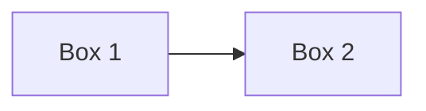

# web-client (Title)
## Header 1
### Header 2
#### Header 3
##### Header 4
###### Header 5

You can use HTML Tags too:
<h1>Web Client</h1>

This is a sample text in **Bold**, *Italics* and ***Bold-Italics***.

Link:

HTML: <a href="https://google.com">Google.com</a>
<br>
MD: [Google.com](https://google.com)

Bullet Points:

- item 1
  - Item 4
- item 2
- item 3

Table:

| Name | Age | Location |
|---|---|---|
| John | 23 | Montreal |
| Doe | 25 | Laval |
| Mary | 28 | Troi-Rivier |

Now I want to talk about `git clone` command.

Now, what about a code:

```
<b>Hello</b>
<i>World!</i>
```

```html
<b>Hello</b>
<i>World!</i>
```

```python
@dataclass
class Board:
    """A group of apps (`<name>.brd`)."""
    name: str
    label: str
    auth: bool
```

