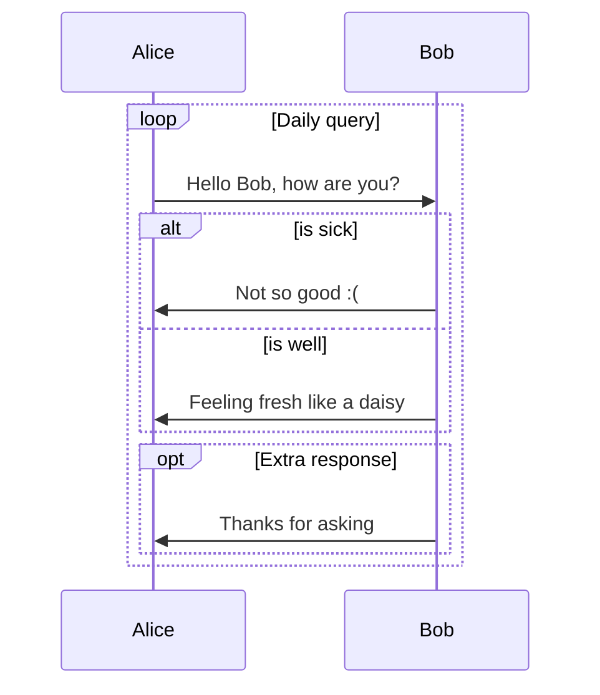

# web-client
## Header 1
### Header 2
#### Header 3
##### Header 4
###### Header 5

You can use HTML Tags too:
<h1>Web Client</h1>

This is a sample text in **Bold**, *Italics* and ***Bold-Italics***.

Link:

HTML: <a href="https://google.com">Google.com</a>
<br>
MD: [Google.com](https://google.com)

Bullet Points:

- item 1
  - Item 4
- item 2
- item 3

Table:

| Name | Age | Location |
|---|---|---|
| John | 23 | Montreal |
| Doe | 25 | Laval |
| Mary | 28 | Troi-Rivier |

Now I want to talk about `git clone` command.

Now, what about a code:

```
<b>Hello</b>
<i>World!</i>
```

```html
<b>Hello</b>
<i>World!</i>
```

```python
@dataclass
class Board:
    """A group of apps (`<name>.brd`)."""
    name: str
    label: str
    auth: bool
```




LaTeX:

$$
\begin{aligned}
\rho \left( \frac{\partial \mathbf{u}}{\partial t} + \mathbf{u} \cdot \nabla \mathbf{u} \right) &= -\nabla p + \mu \nabla^2 \mathbf{u} + \mathbf{f} \\
&= -\nabla p + \mu \left( \frac{\partial^2 \mathbf{u}}{\partial x^2} + \frac{\partial^2 \mathbf{u}}{\partial y^2} + \frac{\partial^2 \mathbf{u}}{\partial z^2} \right) + \rho \mathbf{g}
\end{aligned}
$$

If I want to write a formula like $\rho \left( \frac{\partial \mathbf{u}}{\partial t} + \mathbf{u} \cdot \nabla \mathbf{u} \right)$ within a sentence.

$$
\mathbf{\dot{x}}(t) = 
\begin{bmatrix} 
0 & 1 & 0 \\ 
0 & 0 & 1 \\ 
-k_p & -k_d & -\alpha 
\end{bmatrix} \mathbf{x}(t) + 
\begin{cases} 
\mathbf{B}_1 u(t), & \text{if } t \le t_0 \\ 
\mathbf{B}_2 u(t) + \mathbf{w}(t), & \text{if } t > t_0 
\end{cases}
$$
